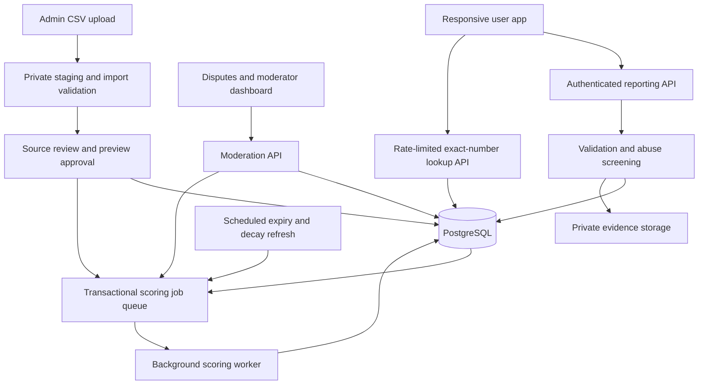

# India Phone Reputation System — MVP Design

## 1. Goal and scope

Build a system where users voluntarily report suspicious calls or messages, look up a number, and see an explainable, recent community risk signal.

This is a proposed architecture, not an implemented application or a compliance certification.

**Important distinction:** more credible, independent reports increase support for a warning. They do not establish the caller's identity or prove a crime. Caller-ID spoofing, coordinated reports, and number reassignment can produce false positives.

The MVP supports:

- Manual phone-number reporting and exact-number lookup.
- Separate scores for suspected fraud and unwanted marketing/spam.
- Optional, private evidence upload.
- Moderation, report withdrawal, and number-holder disputes.
- An internal administrator dashboard and versioned scoring policy.
- Administrator-only pre-seeding and bulk imports with source review, preview, deduplication, and batch rollback.

Not included initially: automatic call interception/blocking, address-book upload, continuous call-log collection, government-data ingestion, bulk public number exports, or machine-learning probability claims.

## 2. Architecture



Start with a modular monolith rather than microservices:

- **Client:** React and TypeScript, responsive for phones and desktop.
- **API:** Node.js and TypeScript, with schema validation and authenticated sessions.
- **Database:** PostgreSQL, with indexed exact-number keys and persisted reputation summaries.
- **Worker:** a separate worker process using a PostgreSQL-backed durable job queue.
- **Evidence:** private object storage, never a public upload directory.
- **Operations:** structured logs without raw phone numbers or evidence, error monitoring, and audit records.

One transaction inserts a report and its scoring job. The worker retries safely and recalculates from accepted reports rather than blindly incrementing a counter. This prevents lost updates and double-counting.

No Redis or separate search engine is necessary for the MVP. Add caching later only if measured lookup load requires it.

## 3. Main user flows

### Submit a report

1. User signs in. Verified contact details help limit anonymous abuse, but do not prove honesty or unique human identity.
2. User provides the caller/sender number, communication time, channel, and category.
3. The app explains what will be stored, what may appear publicly, and how to withdraw a report.
4. Optional evidence enters private quarantine for upload validation and redaction.
5. API normalizes the number, validates the request, applies rate limits and duplicate checks, and records it.
6. The API returns a report ID and status. Submission is not necessarily publication.
7. Screening accepts a report, rejects it with an internal reason, or places it in review.
8. Accepted reports trigger score recomputation. The lookup page includes the score's update time.

For user-report collection, only collect numbers users deliberately report. Do not upload their whole address book or call history. Administrator imports follow the separate, source-reviewed workflow below.

### Pre-seeding and bulk import

Support CSV first, with a configurable MVP limit of 50,000 rows and 20 MB per file. Process uploads asynchronously in bounded chunks; larger datasets can use multiple batches. Bulk upload means an administrator imports an authorized dataset, not that ordinary users can upload contact lists.

1. Register a data source with owner/provider, original upstream provenance, acquisition date, permitted use, license/permission reference, display rights, expiry, and review status.
2. Upload the file to private staging. Require a source ID, file checksum, import idempotency key, and authenticated uploader.
3. Parse with a strict schema and row/file limits. Preserve phone numbers as strings and never evaluate spreadsheet formulas.
4. Normalize numbers, validate categories and dates, and flag invalid, duplicate, stale, and unsupported rows. A claimed observation date must not be silently replaced with the upload date.
5. Show a dry-run preview: new numbers, existing numbers, new source observations, duplicate observations, invalid rows, excluded rows, and proposed public-display effects.
6. An authorized reviewer checks source rights and the preview before committing. Unreviewed sources or sources without sufficient provenance cannot publish allegations.
7. Commit staged observations with batch attribution, then queue reputation updates. Number records may be created before any risk signal becomes publishable.
8. Show progress and a protected row-error download. Escape formula-leading text in exported CSVs.
9. Support batch rollback by revoking that batch's observations and recomputing affected reputations. Retain records supported by other batches or user reports.

Proposed CSV columns:

```text
phone_number,category,observed_at,external_record_id,source_score,source_score_scale,expires_at
```

`source_score` and `source_score_scale` are optional and stored as provider-specific values, not silently converted to our community score. Source registration is required separately so an uploader cannot assign their own source trust inside the CSV.

Import modes:

- **Number-only seed:** creates a searchable number record but no allegation and no risk score.
- **Source observation seed:** stores a sourced fraud/spam allegation with its date and permitted display. Publishes only after source and batch approval.
- **Synthetic test seed:** isolated in non-production environments and never published as genuine evidence.

A number-only seed has an `unknown` reputation. A source observation may be shown as “Listed by an approved external source” when its license permits public display; this describes provenance, not verified fraud.

Approved users may look up externally seeded records before community reports arrive. The community score remains null until its normal reporter-count gates are met, and the source signal is displayed separately.

Pre-seeding is a capability, not a claim that an India spam dataset has been acquired. No source or raw dataset is approved by this design alone.

### Look up a number

1. Normalize the submitted number and derive its exact-match lookup key.
2. Read its reputation summary.
3. Return the public label, separate category scores when eligible, freshness, and plain-language limitations.
4. For missing or insufficient evidence, return **Unknown / insufficient reports**, not “Safe.”

### Withdraw or dispute

- Reporters can withdraw their own reports; those contributions are removed and scores recalculated.
- Number holders can request correction or reassignment review.
- Control of a number does not automatically erase earlier reports or prove innocence.
- An unresolved dispute is visible as a dispute status, not an automatic score reduction.
- A moderator can invalidate demonstrably false reports, restrict suspected coordinated reports, or establish a new reputation period after a reviewed reassignment claim.
- Every decision has an audit record and triggers recomputation.

## 4. Data model

| Table | Important fields | Purpose |
|---|---|---|
| `users` | id, authentication subject, verified-contact flag, created_at, restricted_at | Reporter account and access controls |
| `phone_numbers` | id, lookup_key, encrypted_e164, key_version, created_at, reputation_epoch | Number normalization, exact matching, protected storage |
| `reports` | id, phone_id, reporter_id, channel, category, event_at, submitted_at, status, withdrawn_at, screening_reason, reputation_epoch | Individual allegation and its lifecycle |
| `evidence` | id, report_id, private_object_key, content_type, scan_status, redaction_status, expires_at | Restricted evidence, separate from public reputation |
| `reporter_quality` | reporter_id, quality_tier, reviewed_valid_count, reviewed_invalid_count, policy_version | Conservative, auditable contribution weighting |
| `reputations` | phone_id, category, score, eligible_reporter_count, effective_evidence, public_label, last_report_at, computed_at, next_refresh_at, policy_version | Fast lookup and explainability |
| `disputes` | id, phone_id, claimant_id, reason, status, decision_at | Correction and reassignment requests |
| `moderation_actions` | id, actor_id, target_type, target_id, action, reason_code, created_at | Decisions and accountability |
| `scoring_jobs` | id, phone_id, run_after, state, attempts, deduplication_key | Durable recalculation queue |
| `consent_events` | user_id, notice_version, action, created_at | Record notices and permissions relevant to reporting |
| `data_sources` | id, provider, provenance_group_id, permission_reference, permitted_use, display_allowed, review_status, valid_until | Source registry and approved usage scope |
| `import_batches` | id, source_id, uploader_id, reviewer_id, file_checksum, idempotency_key, state, row_counts, committed_at, revoked_at | Upload preview, approval, progress, and rollback |
| `import_rows` | batch_id, row_number, validation_status, error_code, observation_id | Bounded staging and row-level outcomes |
| `source_observations` | id, phone_id, source_id, provenance_group_id, external_record_id, category, observed_at, source_score, source_score_scale, expires_at, status, reputation_epoch | External allegations distinct from user reports |
| `observation_batch_links` | observation_id, batch_id, active | Many-to-many attribution so rollback does not remove evidence independently supported by another batch |

### Important constraints

- Unique index on `phone_numbers.lookup_key`.
- Unique request idempotency key per reporter to prevent retry-created duplicates.
- A user may submit different incidents involving the same number, but scoring counts at most one active contribution per reporter per number per category.
- Index reports on `(phone_id, category, status, event_at)`.
- Unique summary on `(phone_id, category)`.
- Separate report workflow status from public number labels.
- Unique import idempotency key per source. Re-uploading a file must not manufacture new observations.
- Deduplicate observations by original provenance and external record ID when available; otherwise use a canonical fingerprint of normalized number, category, observed date, and provenance.
- Maintain batch-to-observation links even for overlapping imports so revoking one batch preserves other active attributions.
- Never manufacture users or independent-report counts from imported rows or a vendor's claimed report count.
- Sources reselling the same upstream feed belong to the same provenance group; different vendor names do not automatically establish independence.

### Number handling

Use a maintained phone-number library to validate and normalize to E.164, with India as the default region. Support valid Indian mobile and landline numbers rather than assuming every number has the mobile format.

For database matching, use a secret-key HMAC of normalized E.164. Store the raw number separately with encryption and restricted access. An ordinary unsalted hash is not sufficient because the number space is enumerable. HMAC and encryption are security measures, not a claim that the data is anonymous.

SMS alphanumeric sender headers need a separate identifier model later; do not force them into phone-number records.

## 5. Report categories

Keep these top-level categories separate:

- **Suspected fraud:** impersonation, OTP/payment requests, phishing, fake employment, investment scams, or similar deceptive conduct.
- **Unwanted marketing/spam:** unsolicited promotions, persistent sales calls, or automated marketing.

One person's unwanted sales call must not automatically increase the fraud score. Add harassment or threats later as separate workflows with appropriate moderation.

The user chooses a category. A moderator may correct it, with an audit trail. No automated text classification is required at launch.

## 6. Scoring design

### What the score means

The 0–100 score is a **community report strength index**, not a calibrated probability that a person committed fraud.

For each number and category, choose one contribution per eligible reporter from accepted, non-withdrawn reports in the previous 180 days and current reputation epoch. Use the strongest valid contribution within that window; repeated reports from the same person cannot keep adding weight.

For reporter `i`:

```text
contribution_i =
    reporter_weight_i
    × evidence_weight_i
    × recency_weight_i

recency_weight_i = 2 ^ (-age_in_days / 60)

E = sum(eligible contributions after abuse controls)

score = min(95, round(100 × (1 - exp(-E / 6))))
```

`age_in_days` uses the validated communication timestamp. Reject future timestamps and flag suspicious backdating. The 60-day half-life and 180-day window are proposed launch parameters, not empirically calibrated values.

### Proposed weights

| Signal | Weight | Rule |
|---|---:|---|
| New verified account | 0.25 | Verification alone is weak evidence of independence |
| Established account in good standing | 0.50 | Age alone cannot qualify an account for the highest tier |
| Reporter with a reviewed history of valid reports | 1.00 | Promotion requires reviewed outcomes, not report volume or agreement with a popular label |
| Report without independently reviewed corroboration | 1.00 | A screenshot upload alone does not earn more weight |
| Independently reviewed corroborating evidence | 1.25 | Corroborates an incident; still does not prove caller identity |

Restrict or hold suspicious contributions rather than assigning trust based on who reports the most. A reporter's trust must not rise merely because other reporters agree with them.

### Worked example

For recent reports with weight 1.0, no evidence boost, and no decay:

| Independent eligible reporters | Effective evidence E | Internal score |
|---:|---:|---:|
| 1 | 1 | 15 |
| 3 | 3 | 39 |
| 5 | 5 | 57 |
| 10 | 10 | 81 |
| 20 | 20 | 95, capped |

Ten newly verified accounts at weight 0.25 produce E = 2.5 and an internal score of approximately 34, not 81. This reduces—but does not eliminate—Sybil attacks.

After 60 days without new accepted incidents, existing contributions halve. Recompute daily and after every relevant report or moderation change.

### Public display gates

Count recent distinct eligible reporters, not report submissions. Distinct accounts are only a proxy for distinct people; suspected coordinated activity must be held for review before satisfying these gates.

Proposed public labels:

- **Unknown / insufficient reports:** fewer than 3 eligible reporters in the last 90 days, regardless of internal score.
- **Some suspicious reports:** at least 3 recent eligible reporters, with score below 60.
- **Elevated community risk signal:** score 60–79 and at least 5 recent eligible reporters.
- **Strong community risk signal:** score at least 80, at least 10 recent eligible reporters, and no unresolved coordination concern.

If the score exceeds a label threshold but its reporter-count gate is not met, show only the highest label whose requirements are satisfied.

Do not display “confirmed fraudster,” invent a person's identity, or automatically block calls solely from this index. Explain that reports relate to communications displaying the number and may not identify its current owner.

### Calibration later

Collect independently reviewed outcomes, sample both flagged and unflagged numbers, and evaluate precision/false-positive rate by category and number age. Only call the output a probability after validation on representative, held-out cases. Report volume alone cannot supply unbiased ground truth.

### Imported data and scoring

For the MVP, keep two independent outputs:

- **Community report strength:** computed only from eligible user reports using the formula and publication gates above.
- **External source signals:** approved, unexpired observations with provenance, freshness, provider-specific score/scale if present, and dispute status.

Ten thousand repeated rows from one feed are not ten thousand independent people. A bulk list contributes zero to the community reporter count. Invalid, revoked, stale, or unlicensed source observations contribute no public source signal.

If a licensed source lacks public-display permission, keep its observations restricted internally or do not ingest them if the approved purpose does not allow storage. If even a source's name cannot be disclosed, do not publish a source signal in the MVP.

Example: a number imported twice from the same licensed feed and reported by two eligible users has one external observation, two community reporters, and an unpublished community score. It may show the permitted external-source warning, but not a strong community-fraud label.

A single combined index can be considered later only with documented source normalization, validated source accuracy, upstream overlap controls, and separately visible provenance. Do not add arbitrary seed points to the community score.

## 7. Abuse resistance

- Limit submissions per account and use conservative network-level limits.
- Require authenticated reporting, idempotency keys, and duplicate detection.
- Quarantine bursts, repeated targeting, and suspicious account clusters.
- Do not treat shared Wi-Fi/IP as proof of coordination; use it only as a review signal.
- Do not reveal reporter identities, raw evidence, or internal anti-abuse signals in public lookup responses.
- Apply exact-number lookup quotas; no prefix search, bulk export, or public enumeration endpoint.
- Minimize and expire abuse-detection metadata; avoid invasive fingerprinting by default.
- Test reputation poisoning explicitly: repeated submissions, newly created account bursts, fabricated screenshots, stale reports, and malicious disputes.

No simple account-verification scheme guarantees one human per report. Human review and conservative public labels remain necessary.

## 8. API boundaries

| Endpoint | Access | Behavior |
|---|---|---|
| `POST /v1/reports` | Authenticated, rate-limited | Submit allegation with idempotency key |
| `GET /v1/reports/mine` | Authenticated | Retrieve only the user's reports |
| `POST /v1/reports/:id/withdraw` | Report owner | Withdraw and queue recalculation |
| `POST /v1/evidence/uploads` | Authenticated, tied to own report | Issue a short-lived private upload URL |
| `POST /v1/lookup` | Authenticated in MVP, rate-limited | Exact-number lookup; number in request body, not URL logs |
| `POST /v1/disputes` | Authenticated | Submit correction/reassignment request |
| `POST /v1/admin/reports/:id/decision` | Moderator | Accept, reject, recategorize, or hold with reason |
| `POST /v1/admin/disputes/:id/decision` | Moderator | Resolve dispute with audit and recalculation |
| `POST /v1/admin/data-sources` | Authorized source administrator | Register provenance and permission details for review |
| `POST /v1/admin/imports` | Import administrator | Start private CSV staging with source ID and idempotency key |
| `GET /v1/admin/imports/:id` | Authorized import staff | Progress, preview, counts, and protected row-error access |
| `POST /v1/admin/imports/:id/commit` | Authorized reviewer | Approve preview and enqueue resumable import |
| `POST /v1/admin/imports/:id/rollback` | Authorized administrator | Revoke batch contributions and enqueue recalculation |

Illustrative lookup response:

```json
{
  "identifier_type": "phone",
  "fraud": {
    "score": 81,
    "score_type": "community_report_strength",
    "label": "strong_community_risk_signal",
    "support_band": "10_or_more_recent_eligible_reporters"
  },
  "spam": {
    "score": null,
    "label": "insufficient_reports"
  },
  "external_signals": [],
  "dispute_status": "none",
  "computed_at": "<ISO-8601 timestamp>",
  "policy_version": "v1",
  "warning": "Based on user reports; not proof of fraud or caller identity."
}
```

Avoid public exact reporter counts where they could reveal individual activity. Use coarse support bands and never echo reporter identifiers.

## 9. Privacy and operational safeguards

The architecture does not establish a lawful basis by itself. Before launch, have Indian privacy counsel review collection of reported numbers, public reputation display, rights handling, retention, and any evidence processing. A reporter's permission to submit their own data does not automatically authorize every use of someone else's phone number.

Proposed safeguards:

- Clear, versioned reporting notice and narrow purpose.
- No public complainant details or unmoderated free-text allegations.
- Separate moderator roles, least-privilege evidence access, and audited access.
- Encryption, secrets management, private backups, and tested restore procedures.
- Evidence quarantine, content-type/size limits, malware checks, metadata stripping where practical, and redaction before moderator access.
- No call recordings or bulk contact uploads in the MVP.
- Administrator dataset imports are separate from contact uploads and require source/permission review. Treat staging files, error exports, and provider records as protected data; expire staging after a proposed 7-day troubleshooting window, subject to the approved retention policy.
- Removing an expired or revoked source must suppress its public signals, queue recalculation, and delete restricted records when required by the applicable retention or license terms.
- Suggested initial retention: evidence 30 days and report records 180 days, subject to legal review and narrowly controlled case holds.
- Expire old report contributions and remove unnecessary personal data from logs and backups according to a documented schedule.
- Account deletion/withdrawal removes applicable contributions and triggers score recomputation.
- Do not expose detailed security logs or claimant evidence publicly.

## 10. Reliability and verification

Track:

- Accepted, held, rejected, and withdrawn reports.
- Unique eligible reporters versus total submissions.
- Submission-to-score delay and scoring job failures.
- Numbers with stale summaries or insufficient support.
- Moderation overturn rate, upheld disputes, and suspected coordination.
- Lookup latency, abuse-related rate limits, and private-evidence access.
- Import preview/commit throughput, invalid/duplicate row rates, approval failures, source expiry, and rollback completion.

Essential tests before launch:

- Number normalization, validation, and exact matching.
- One reporter submitting 100 incidents contributes only once per number/category.
- Accepted reports count; pending, rejected, and withdrawn reports do not.
- Marketing reports never raise the fraud score.
- Time decay, window expiry, public-label gates, and score cap.
- Concurrent submissions and retried jobs produce deterministic scores.
- Moderator decisions and report withdrawal recompute the score.
- Lookup access cannot expose reporters or evidence.
- New account bursts and unresolved coordination cannot automatically create strong warnings.
- Missing reputation returns unknown, never safe.
- Key rotation and reassignment epochs do not accidentally duplicate or inherit obsolete reputation.
- Importing the same dataset repeatedly cannot increase community report counts or duplicate source observations.
- Dry-run previews have no public effects; only authorized commits publish permitted observations.
- Partial import failures and retries resume without duplicating records.
- Overlapping batches retain valid shared observations when one batch is rolled back.
- Source expiry, permission revocation, stale observations, and number reassignment remove applicable external signals.
- Missing provider-score scales and historical dates are not invented or silently interpreted as current community evidence.
- Malformed files, excessive rows, formula injection in error exports, and uploads by non-admin users are handled safely.

## 11. Delivery sequence

1. **Private pilot:** authenticated manual reporting, exact lookup, separate category scores, moderation, withdrawals, basic disputes, and administrator CSV imports with source registry, preview, approval, deduplication, and rollback. Use synthetic seeds until real sources are approved.
2. **Evidence pilot:** private uploads and reviewed corroboration once retention/redaction processes are ready.
3. **Controlled expansion:** tune thresholds using reviewed outcomes, instrument abuse detection, and measure false positives.
4. **Automated external feeds later:** scheduled government or commercial ingestion only under an appropriate access arrangement and license. Reuse the same source registry and observation pipeline as bulk uploads; retain provenance and prevent upstream overlap from being interpreted as independent corroboration.

**Recommended starting point:** a responsive app and one backend with PostgreSQL. Keep scoring deterministic and explainable until independently reviewed outcomes justify a more complex model.
